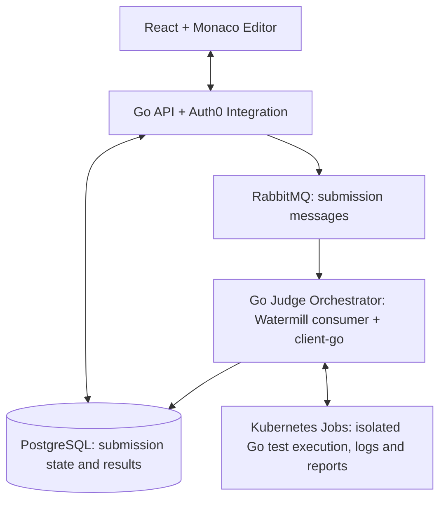

# GoJudge

**MVP Project Proposal | Go Internship**

Version 0.1 • 26 October 2026 • Status: Draft for Expert Review

Project context: 8 Go-proficient interns, 12 weeks, team-based delivery using Specification-Driven Development (SDD).

# 1. Executive Summary

GoJudge is a lightweight coding-challenge platform inspired by LeetCode. Learners browse programming problems, write Go solutions in a browser editor, run public examples, submit solutions, and receive automated verdicts against private test cases. Administrators manage problems and test suites.

The proposed deliverable is a demonstrable, deployable MVP, not a production-scale LeetCode clone. The engineering focus is on idiomatic Go backend development, asynchronous processing, execution isolation, testing, observability, API contracts, and collaborative delivery.

# 2. Product Goals and Target Users

| User                               | Primary goal                                                                         |
|------------------------------------|--------------------------------------------------------------------------------------|
| Learner                            | Discover Go problems, submit code, understand verdicts and review prior submissions. |
| Administrator / Content Maintainer | Create, update, publish and maintain problems, examples and hidden tests.            |
| Project Team / Operator            | Deploy, observe and troubleshoot the application and execution workers.              |

Success scenario: an authenticated learner selects a published problem, writes a Go solution, runs example tests, submits it for full evaluation, and views the final verdict and submission history.

# 3. MVP Functional Scope

| ID  | Feature                | Priority | Expected behaviour                                                                          |
|-----|------------------------|----------|---------------------------------------------------------------------------------------------|
| F01 | Accounts and access    | Must     | Register, sign in/out; learner and administrator roles.                                     |
| F02 | Problem catalogue      | Must     | List published problems with title, difficulty and solved state.                            |
| F03 | Problem details        | Must     | Display statement, input/output contract, constraints and public examples.                  |
| F04 | Browser code editor    | Must     | Edit Go source code; load a starter template; preserve current work in the active session.  |
| F05 | Run sample tests       | Must     | Execute code against public sample tests and return per-case feedback.                      |
| F06 | Submit solution        | Must     | Create asynchronous submission; return submission ID and processing state.                  |
| F07 | Automated judge        | Must     | Compile and execute submitted Go code in isolation; evaluate hidden tests; produce verdict. |
| F08 | Submission history     | Must     | Show own submissions, timestamps, states and final verdicts.                                |
| F09 | Problem administration | Must     | Admin CRUD, draft/published status, sample and hidden test management.                      |
| F10 | Progress tracking      | Should   | Solved/attempted counts and per-problem completion status.                                  |
| F11 | Catalogue filters      | Should   | Filter by difficulty and topic tags.                                                        |
| F12 | Leaderboard            | Could    | Simple ranking based on accepted solutions; only if core scope is complete.                 |

## Verdicts and submission lifecycle

Submissions follow an asynchronous lifecycle: QUEUED → RUNNING → COMPLETED or FAILED. The evaluation engine executes Go test suites and collects test execution results, process exit codes, and diagnostic output.

Evaluation verdicts include ACCEPTED, WRONG_ANSWER, COMPILATION_ERROR, RUNTIME_ERROR, TIME_LIMIT_EXCEEDED, MEMORY_LIMIT_EXCEEDED, and INTERNAL_ERROR.

Test failures must be distinguished from infrastructure failures. Retries must not create duplicate or conflicting final results. Detailed test feedback may be returned according to the visibility rules defined for each problem.

## Problem Format and Evaluation Model

The MVP will support Go-based coding challenges evaluated through the standard Go testing framework.

Each problem will define a submission contract, starter code, a predefined test suite, and expected evaluation behaviour. Supported challenge types may include algorithms, functions, HTTP handlers, and selected software components.

Submitted code will be combined with trusted test assets and evaluated in an isolated execution environment using go test. The judge will collect structured test results, execution status, and diagnostic logs.

For the initial MVP, only Go submissions are supported. The exact challenge packaging format and test visibility rules will be finalised during the architecture design phase.

# 4. Explicitly Out of Scope

Multiple programming languages; live contests; social feeds; discussion forums; AI tutoring; plagiarism detection; paid plans; complex ranking algorithms; production-grade multi-region scaling; user-generated public problems; real-time collaborative editing.

# 5. Recommended Technology Stack

| Layer                   | Recommendation                                                            | Rationale                                                                      |
|-------------------------|---------------------------------------------------------------------------|--------------------------------------------------------------------------------|
| Backend API             | Go (current supported stable release); standard net/http + chi (optional) | Idiomatic Go, limited framework overhead.                                      |
| Persistence             | PostgreSQL                                                                | Persistent storage for problems, submissions, metadata and evaluation results. |
| Database access         | pgx + sqlc                                                                | Typed SQL access with explicit queries.                                        |
| Frontend                | React + TypeScript + Vite                                                 | Thin web client; Go remains primary engineering focus.                         |
| Code editor             | Monaco Editor                                                             | Browser-based code editing experience.                                         |
| Execution orchestration | Go Judge Orchestrator + Kubernetes Jobs                                   | Per-submission execution, resource management and lifecycle monitoring.        |
| Job queue               | RabbitMQ                                                                  | Avoids introducing another distributed service early.                          |
| API contract            | OpenAPI 3.x                                                               | Reviewable interface and contract-based testing.                               |
| Deployment              | Kubernetes; GKE or VM-hosted k3s subject to approval                      | Reproducible deployment with a defined hosting budget.                         |
| CI/CD                   | GitHub Actions                                                            | Build, lint, tests, dependency/security checks.                                |
| Observability           | Structured logs, health endpoints, basic metrics                          | Operational visibility and failure diagnosis.                                  |
| Authentication          | Auth0 (OIDC/OAuth 2.0)                                                    | Managed identity, avoiding custom authentication implementation.               |
| Messaging               | RabbitMQ + Watermill                                                      | Asynchronous submission dispatch with a reusable Go messaging abstraction.     |
| Kubernetes integration  | client-go                                                                 | Programmatic creation, monitoring and cleanup of execution Jobs.               |
| Local infrastructure    | k3d or Minikube                                                           | Local Kubernetes environment for development and integration testing           |

Authentication will use Auth0 as the managed identity provider. RabbitMQ and Watermill are the proposed messaging stack, while Kubernetes Jobs and client-go are the preferred execution orchestration technologies. Final hosting, isolation controls, and resource budgets remain subject to technical validation.

# 6. Proposed Architecture

GoJudge will use a modular Go backend with PostgreSQL for persistent application data, RabbitMQ for asynchronous messaging, and Watermill for message publishing and consumption.

The submission workflow will be coordinated by a Go Judge Orchestrator. Upon receiving a submission message, the orchestrator will create a Kubernetes Job using client-go. Each Job will execute the submitted Go code against a predefined test suite in an isolated environment.

The orchestrator will monitor execution status, collect test results and diagnostic output, and persist the final evaluation outcome in PostgreSQL.

The architecture will separate message delivery, execution orchestration, and submission state management. Idempotent processing, failure recovery, and execution resource limits will be mandatory design requirements.

The frontend will remain a thin React application communicating with the Go backend through REST APIs.

# 7. Security and Execution Isolation

Running untrusted submitted code is the highest-risk feature. Docker alone is not a sufficient security boundary. The execution design must include a reviewed isolation model, unprivileged execution, no network access, read-only/minimal filesystem access, process/CPU/memory/time limits, bounded output, cleanup, cancellation, and protection of hidden tests and platform secrets.

Workers must not receive database credentials or secrets beyond their minimum needs. The judge environment should be separated from the API host where feasible. Public exposure must be blocked until isolation controls and adversarial tests pass. If safe execution cannot be demonstrated, release remains internal-only or uses a vetted external sandbox service.

### Kubernetes Execution Security

Each submission will execute in a dedicated Kubernetes Job with explicitly configured CPU, memory, and execution time limits.

Execution Pods must run without elevated privileges, with restricted filesystem access, disabled unnecessary network connectivity, and no access to application secrets or Kubernetes API credentials.

Kubernetes RBAC, namespace isolation, resource quotas, and appropriate Pod security controls must be configured and validated.

Job retry policies must distinguish infrastructure failures from compilation errors and failed tests. Failed learner solutions must not trigger automatic execution retries.

Execution logs and test reports must be collected before Job cleanup. Kubernetes Job TTL and cleanup policies must prevent resource accumulation.

The final isolation mechanism must undergo a dedicated security review before public deployment.

# 8. Non-Functional Requirements and Quality Gates

| Area            | MVP acceptance target                                                                                                                                                                                        |
|-----------------|--------------------------------------------------------------------------------------------------------------------------------------------------------------------------------------------------------------|
| Correctness     | Deterministic verdicts for agreed reference solutions and negative test cases.                                                                                                                               |
| Reliability     | Submissions must survive normal service restarts and message redelivery. Processing must be idempotent, with consistent state transitions and controlled retry policies across RabbitMQ and Kubernetes Jobs. |
| Security        | Role-based access; protected hidden tests; isolation threat model reviewed and validated.                                                                                                                    |
| Performance     | The staging environment must demonstrate successful concurrent execution of at least two independent submissions, with correct result persistence, resource isolation, and no duplicate final evaluations.   |
| Maintainability | Modular structure, documented APIs, migrations, consistent errors and structured logging.                                                                                                                    |
| Testing         | Unit, integration and critical end-to-end tests; worker failure and timeout scenarios.                                                                                                                       |
| Delivery        | Reproducible staging deployment, CI green, operator README and known limitations documented.                                                                                                                 |

# 9. Proposed 12-Week Delivery Milestones

| Weeks | Milestone                       | Evidence                                                                                                                                                    |
|-------|---------------------------------|-------------------------------------------------------------------------------------------------------------------------------------------------------------|
| 1–2   | Architecture and vertical slice | Approved scope, ADRs, CI, initial API/DB slice; isolation feasibility spike. Kubernetes feasibility spike, Auth0 and RabbitMQ check                         |
| 3–4   | Core platform                   | Accounts, problem management, catalogue and contracts. Integration Auth0, PostgreSQL, starting messaging contracts                                          |
| 5–6   | Submission pipeline             | Durable queue, lifecycle, worker with controlled/mock executor. RabbitMQ + Watermill, submission lifecycle, Kubernetes Job orchestration with text executor |
| 7–8   | Judge integration               | Go compilation/execution and hidden tests in reviewed isolation. go test, Kubernetes execution, test reports, isolation controls                            |
| 9–10  | End-to-end MVP                  | Editor, run/submit, history, admin flow, staging E2E.                                                                                                       |
| 11–12 | Release hardening               | Security/performance review, fixes, deployment and final demo.                                                                                              |

# 10. SDD Delivery Rules

Each feature begins with a concise Markdown specification covering user behaviour, acceptance criteria, edge cases, API/data contracts, security implications and verification scenarios. A peer from another pair reviews the spec before implementation. Implementation may use AI assistance, but interns own design decisions, correctness, tests and code review. Material scope changes require spec and contract updates.

Recommended artefacts: Product Vision, MVP Scope, feature specs, OpenAPI contract, Architecture Decision Records (ADRs), test evidence, release checklist and operational runbook.

# 11. Release Acceptance Criteria

A learner can complete the full browse → edit → run samples → submit → view verdict → view history journey. An administrator can publish a problem with public examples and private tests. Judge verdicts match reference fixtures; worker restarts and timeouts are handled; role boundaries hold; isolation passes expert security review; staging deployment is repeatable; no unresolved critical/high defects remain.

The release must demonstrate successful evaluation of Go submissions using predefined test suites, including at least one algorithmic challenge and one HTTP-handler challenge.

The system must execute at least two submissions concurrently through Kubernetes Jobs, correctly handle test failures and execution timeouts, and persist consistent final results.

Message redelivery, service restarts, and Kubernetes Job failures must not produce conflicting submission states.

The deployment must pass the agreed execution isolation and security acceptance checks.

# 12. Decisions Requested from Technical Expert

| Decision                | Status   | Proposed outcome                                             |
|-------------------------|----------|--------------------------------------------------------------|
| Submission evaluation   | Proposed | Go testing framework instead of stdin/stdout-only evaluation |
| Execution orchestration | Proposed | Kubernetes Jobs + client-go                                  |
| Frontend                | Approved | Thin React UI with Monaco                                    |
| Authentication          | Proposed | Auth0                                                        |
| Messaging               | Proposed | RabbitMQ + Watermill                                         |
| Concurrency target      | Proposed | Minimum 2 concurrent submissions                             |
| Local infrastructure    | Proposed | k3d or Minikube                                              |
| Hosting                 | Open     | GKE, VM-hosted k3s or another approved environment           |
| Execution isolation     | Open     | Validated sandbox configuration and security controls        |
| Scope trade-off         | Approved | Defer F10–F12 before weakening security                      |
